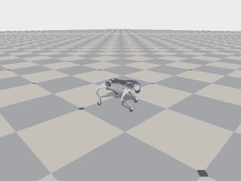

# Your first RL policy in Isaac Lab

<p align="center"></p>

A hands-on, single-notebook introduction to robot learning with **[Isaac Lab](https://github.com/isaac-sim/IsaacLab) 3.0**
on the **Newton** physics engine: no Isaac Sim needed, runs on a laptop GPU (tested on an RTX 5070 Laptop, 8 GB).
You go from *"I studied PPO a while ago"* to writing, training, debugging and explaining your own RL tasks,
and end by **driving the quadruped you trained with your keyboard**.

## What you'll learn

| Part | Topic |
|---|---|
| 0 | Setup |
| 1 | RL refresher: MDPs, returns, value functions, advantages |
| 2 | PPO step by step: policy gradient, actor-critic, GAE, the clipped objective (with small code demos) |
| 3 | Isaac Lab basics: scenes, assets, joints, the simulation loop, batched GPU tensors |
| 4 | **Your own task** (cartpole, Direct workflow): observations, actions, rewards, terminations, resets; PPO training; reading training curves; a **reward-hacking** experiment |
| 5 | Manager-based workflow: train a **Unitree Go2** to walk; reward terms; a **local optimum** and how to diagnose it |
| 6 | The terminal workflow (`train`, `play`, TensorBoard) |
| 7 | Recap and interview questions |

Everything runs in the notebook: videos are rendered with a simulated camera and shown under the cells.
Total compute is about 25 minutes (most of it the Go2 training); the rest is reading.

## Requirements

- **Linux** (tested: Ubuntu 24.04), or **Windows 11 with WSL2** (tested: Ubuntu 24.04 on WSL2) → see [docs/windows_wsl_setup.md](docs/windows_wsl_setup.md)
- an **NVIDIA GPU** with a recent driver (8 GB VRAM is enough)
- ~10 GB of disk space

## Quickstart

```bash
git clone <this repository's URL> isaaclab-newton-tutorials
cd isaaclab-newton-tutorials
./install.sh          # uv + Isaac Lab (tested commit) + Python environment, ~10-15 min the first time
./start_jupyter.sh    # then open the printed http://localhost:8888/... link and 01_first_policy.ipynb
```

`install.sh` clones Isaac Lab into `./IsaacLab` (or reuses `../IsaacLab`, or `$ISAACLAB_DIR`) at the commit this
tutorial was tested with, because Isaac Lab's main branch changes quickly.

## Drive a trained robot with your keyboard

A Go2 policy trained with this notebook (1000 PPO iterations, 1 MB) is included, so you can try this right away:

```bash
./run.sh python scripts/drive_policy.py --task Isaac-Velocity-Flat-UnitreeGo2 --checkpoint checkpoints/go2_flat_model_999.pt
```

After notebook 1, drive **your own** Go2 instead with `--checkpoint logs/go2_flat`.
Click into the viewer window, then: **W/S** forward/backward, **A/D** sideways, **Q/E** turn, **Space** stop,
**R** reset, **C** toggle the follow camera.

`drive_policy.py` works for any registered task and RSL-RL checkpoint (`--task`, `--num_envs`, `--speed`, ...;
see the top of the file). [`scripts/drive_go2.py`](scripts/drive_go2.py) is a minimal Go2-only version that's easier to read.

## Repository layout

```
01_first_policy.ipynb   the notebook
install.sh              installs everything (safe to re-run)
start_jupyter.sh        JupyterLab with Isaac Lab's Python environment
run.sh                  run any command with Isaac Lab's environment, e.g. ./run.sh isaaclab list_envs
scripts/                drive_policy.py, drive_go2.py, env.sh (shared settings)
checkpoints/            a trained Go2 policy
docs/                   Windows/WSL setup and troubleshooting
logs/, videos/          created when you run things (not tracked by git)
```

## Troubleshooting

- **The viewer window runs in slow motion (WSL).** OpenGL falls back to a CPU renderer (`llvmpipe`) by default.
  `run.sh` and the scripts set `GALLIUM_DRIVER=d3d12 MESA_D3D12_DEFAULT_ADAPTER_NAME=NVIDIA` to draw on the GPU;
  set them yourself for other OpenGL programs. Details in [docs/windows_wsl_setup.md](docs/windows_wsl_setup.md).
- **The first simulation cell takes long.** NVIDIA Warp compiles its GPU kernels the first time; later runs use a cache.
- **The Go2 stands still after training.** That's a local optimum, discussed in Part 5: train longer (the notebook uses 1000 iterations).
- **`size mismatch` when loading a checkpoint.** The checkpoint comes from a different task: the network's input size
  depends on the task's observations (e.g. the rough-terrain task adds 187 height-scan values).

## Tested with

Isaac Lab `3e7e613` (main, 2026-11-16, v3.0.0), Newton/MJWarp physics, RSL-RL 5.5.1, PyTorch with CUDA,
Ubuntu 24.04 on WSL2, NVIDIA RTX 5070 Laptop GPU (driver 621.24).

## License

[BSD-3-Clause](LICENSE), like Isaac Lab. This repository only uses Isaac Lab and RSL-RL; it doesn't contain their code.
