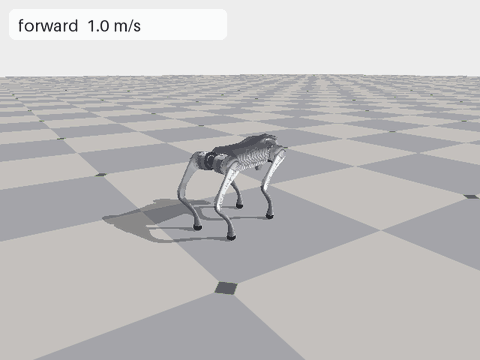
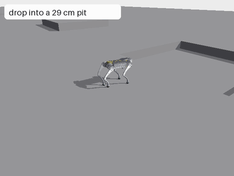

# Isaac Lab on Newton: from your first RL policy to parkour

A hands-on, notebook introduction to robot learning with **[Isaac Lab](https://github.com/isaac-sim/IsaacLab) 3.0**. Runs on a (powerful enough) laptop (tested on an RTX 5070 Laptop, 8 GB) thanks to the use of the new lightweight **Newton** physics engine. As such, no Isaac Sim is needed to run this tutorial. Made to help those who have some basic knowledge of RL to start writing, training, and debugging their own RL tasks.

## Results

| Notebook 1: walking | Notebook 2: parkour |
|---|---|
|  |  |
| A Go2 following velocity commands on flat ground: forward, turning, sideways. 1000 PPO iterations, ~13 min of training. | A Go2 dropping into a 29 cm pit, turning, and climbing out over the wall at an angle. 3000 PPO iterations, ~1 h of training. |

Success rate of the parkour policy at the hardest obstacle size of each type, and averaged over all 10 difficulty
levels (`checkpoints/go2_parkour_model_2999.pt`, 16 robots per tile, walking straight at 0.8 m/s):

| Obstacle | Hardest size | Success at the hardest size | Mean over all levels |
|---|---|---|---|
| climb: wall up | 29 cm | 100 % | 99 % |
| drop: box down | 38 cm | 100 % | 100 % |
| gap | 43 cm | 88 % | 98 % |
| gap onto a step | 33 cm gap + 14 cm step | 100 % | 99 % |
| rough ground | - | 100 % | 100 % |

For scale: the Go2's hips are about 30 cm above the ground.

## What you'll learn

### Notebook 1: your first policy (`notebooks/01_first_policy.ipynb`)

| Part | Topic |
|---|---|
| 0 | Setup |
| 1,2 | RL refresher: MDPs, value functions, PPO recap |
| 3 | Isaac Lab basics: scenes, assets, joints, the simulation loop, batched GPU tensors |
| 4 | Your first task (cartpole, Direct workflow): observations, actions, rewards, terminations, resets; PPO training; reading training curves; a reward-hacking experiment |
| 5 | Manager-based workflow: train a **Unitree Go2** to walk; reward terms; a **local optimum** and how to diagnose it |
| 6 | The terminal workflow (`train`, `play`, TensorBoard) |
| 7 | Recap and test questions |

Everything runs in the notebook: videos are rendered with a simulated camera and shown under the cells.
Total compute is about 20 minutes (most of it the Go2 training); the rest is reading.

### Notebook 2: from walking to parkour (`notebooks/02_parkour_environment.ipynb`)

Builds the environment for a Go2 that climbs walls, jumps down from boxes and jumps across gaps, as a task package
of its own (`parkour/`). The point: the hard part of parkour is the environment design, and every piece of it can
be checked in seconds before spending an hour of GPU time.

| Part | Topic |
|---|---|
| 1 | What changes from walking to parkour (the two MDPs compared) |
| 2 | **Terrain**: Isaac Lab's terrain generator, writing your own obstacle type, inspecting it without a simulator |
| 3 | **Task code**: a custom observation, termination and reward; packaging and registering the task |
| 4 | **Look before you train**: what the robot perceives in front of each obstacle (and a real bug this reveals), testing every new term |
| 5 | **Curriculum** and a sanity training |
| 6 | **Evaluation**: a success-rate map per obstacle type and size |
| 7 | The real training from the terminal (~1 h), monitoring, evaluating, driving the result |
| 8 | Recap and test questions |

About 5 minutes of compute in the notebook; the real training runs in a terminal.

## Requirements

- **Linux** (tested: Ubuntu 24.04), or **Windows 11 with WSL2** (tested: Ubuntu 24.04 on WSL2) → see [docs/windows_wsl_setup.md](docs/windows_wsl_setup.md)
- an **NVIDIA GPU** with a recent driver (8 GB VRAM is enough)
- ~10 GB of disk space

## Quickstart

```bash
git clone https://github.com/andresdiazaguilar/isaaclab-newton-tutorials
cd isaaclab-newton-tutorials
./install.sh          # uv + Isaac Lab + Python environment
./start_jupyter.sh    # then open the printed http://localhost:8888/... link and notebooks/01_first_policy.ipynb
```

`install.sh` clones Isaac Lab into `./IsaacLab` (or reuses `../IsaacLab`, or `$ISAACLAB_DIR`) at the commit this
tutorial was tested with, because Isaac Lab's main branch changes quickly.

## Drive a trained robot with your keyboard

Both trained policies shown above are included, so you can try them immediately:

```bash
./run.sh python scripts/drive_policy.py --task Isaac-Velocity-Flat-UnitreeGo2 --checkpoint checkpoints/go2_flat_model_999.pt
./run.sh python scripts/drive_policy.py --task Go2-Parkour --checkpoint checkpoints/go2_parkour_model_2999.pt
```

The parkour one walks through a 5x5 patch of random obstacles (walls, boxes, gaps); it is trained for forward
walking (0.3-1 m/s) with turning, and only slow sideways steps.
After notebook 1, drive the Go2 with your own policy instead with `--checkpoint logs/go2_flat`.
Click into the viewer window, then: **W/S** forward/backward, **A/D** sideways, **Q/E** turn left/right, **Space** stop,
**R** reset, **C** toggle the follow camera.

`drive_policy.py` works for any registered task and RSL-RL checkpoint (`--task`, `--num_envs`, `--speed`, ...;
see the top of the file). 

## The parkour task

After notebook 2, the task `Go2-Parkour` is available to Isaac Lab's command-line tools (through the
`isaaclab.tasks` entry point of the `parkour/` package, which `run.sh` installs):

```bash
./run.sh isaaclab train --rl_library rsl_rl --task Go2-Parkour                          # ~1 h, logs/rsl_rl/go2_parkour/
./run.sh python scripts/evaluate_parkour.py --checkpoint logs/rsl_rl/go2_parkour         # success-rate map
./run.sh python scripts/drive_policy.py --task Go2-Parkour --checkpoint logs/rsl_rl/go2_parkour
```

The evaluation puts robots on every obstacle type and size and counts how many get 3 m past their spawn point
(past the obstacle) without falling; the table in [Results](#results) comes from it. On this setup the policy clears
almost everything by iteration 2500, so the next step to make it more capable is harder obstacles, not longer training.

## Repository layout

```
notebooks/              01_first_policy.ipynb: RL, PPO, Isaac Lab basics, cartpole, Go2 walking
                        02_parkour_environment.ipynb: building and testing the parkour environment
parkour/                the parkour task package (written by notebook 2's %%writefile cells)
install.sh              installs everything (safe to re-run)
start_jupyter.sh        JupyterLab with Isaac Lab's Python environment
run.sh                  run any command with Isaac Lab's environment, e.g. ./run.sh isaaclab list_envs
scripts/                drive_policy.py, drive_go2.py, evaluate_parkour.py, env.sh (shared settings)
checkpoints/            the two trained Go2 policies shown above (walking, parkour)
media/                  the GIFs in this README
docs/                   Windows/WSL setup and troubleshooting
logs/, videos/          created when you run things (not tracked by git)
```

## Troubleshooting

- **The viewer window runs in slow motion (WSL).** OpenGL falls back to a CPU renderer (`llvmpipe`) by default.
  `run.sh` and the scripts set `GALLIUM_DRIVER=d3d12 MESA_D3D12_DEFAULT_ADAPTER_NAME=NVIDIA` to draw on the GPU;
  set them yourself for other OpenGL programs. Details in [docs/windows_wsl_setup.md](docs/windows_wsl_setup.md).
- **The first simulation cell takes long.** NVIDIA Warp compiles its GPU kernels the first time; later runs use a cache.
- **The Go2 stands still after training.** That's a local optimum, discussed in Part 5: train longer (the notebook uses 1000 iterations).
- **`No module named 'go2_parkour'` in notebook 2.** Start Jupyter with `./start_jupyter.sh` (restart it if it was
  already running before you pulled notebook 2): it installs the `parkour/` package into the environment.
- **`size mismatch` when loading a checkpoint.** The checkpoint comes from a different task: the network's input size
  depends on the task's observations (e.g. the rough-terrain task adds 187 height-scan values).

## Tested with

Isaac Lab `3e7e613` (main, 2026-11-16, v3.0.0), Newton/MJWarp physics, RSL-RL 5.5.1, PyTorch with CUDA,
Ubuntu 24.04 on WSL2, NVIDIA RTX 5070 Laptop GPU (driver 621.24).

## About this repository

I made this repository to guide myself through learning Isaac Lab while being able to run it locally (given a beefy enough laptop), since most tutorials out there were made with Isaac Lab in mind. I'm sharing it in case it can helps others starting out the same way. The material draws on:

- Isaac Lab's official Newton notebooks (`notebooks/explore.ipynb` and `notebooks/training.ipynb` in the
  [Isaac Lab repository](https://github.com/isaac-sim/IsaacLab)),
- Isaac Lab's own task code, in particular the cartpole Direct task and the Go2 velocity-tracking task, which
  the notebook's cartpole environment and Go2 sections are based on,
- the [Isaac Lab documentation](https://isaac-sim.github.io/IsaacLab/),
- the [RSL-RL](https://github.com/leggedrobotics/rsl_rl) library (ETH Zurich's Robotic Systems Lab), which does all
  the training here: its PPO implementation and `OnPolicyRunner` (actor-critic networks, rollouts, updates, logging,
  checkpoints) are what the notebook's `train()` helper and the driving scripts call, and the PPO hyperparameters
  explained in Part 2 are its configuration options,
- the PPO and GAE papers ([Schulman et al., 2017](https://arxiv.org/abs/1707.06347);
  [Schulman et al., 2015](https://arxiv.org/abs/1506.02438)) for the theory parts, and
  [Rudin et al., 2021](https://arxiv.org/abs/2109.11978) (*Learning to Walk in Minutes*), the origin of RSL-RL
  and of Isaac Lab's locomotion tasks,
- for notebook 2: Isaac Lab's terrain generator, terrain-level curriculum and Go2 rough-terrain task, which the
  parkour task builds on; the feet-stumble penalty from ETH's [legged_gym](https://github.com/leggedrobotics/legged_gym);
  and published quadruped parkour work, e.g. [Zhuang et al., 2023](https://arxiv.org/abs/2309.05665)
  (*Robot Parkour Learning*) and [Hoeller et al., 2024](https://arxiv.org/abs/2306.14874) (*ANYmal Parkour*).

The explanations, experiments (reward hacking, the standing-still local optimum), helper scripts and installation
were written for this tutorial and tested on the setup listed above. It was built with the assistance of Claude Code.

## License

[BSD-3-Clause](LICENSE). This repository only uses Isaac Lab and RSL-RL; it doesn't contain their code.
